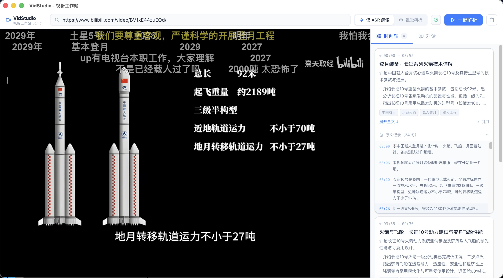

# VidStudio 视析工作站

> 把视频和字幕整理成可检索、可批注、可导出的知识时间轴，支持基于原文的 AI 问答。


---



---

## 简介

VidStudio 视析工作站是一款基于 Electron 的桌面应用，内置 B 站视频播放器与 AI 解析引擎（VidEngine 视析引擎）。输入视频链接后，自动提取字幕或进行语音转文字，通过语义分块与 LLM 结构化处理，生成带时间轴的知识摘要。解析完成后可在对话面板中与视频内容自由问答。

已有字幕可以直接离线导入，无需 Python 或 API Key。视频解析支持字幕优先、语义分块与可选视觉分析；模型与接口可以在应用内配置。下方费用是方案估算，实际价格和免费额度以服务商为准。

---

## 低成本方案

| 功能                  | 模型            | 平台                                      | 费用                                             |
| --------------------- | --------------- | ----------------------------------------- | ------------------------------------------------ |
| ASR 语音转文字        | SenseVoiceSmall | [硅基流动](https://siliconflow.cn)        | 免费额度覆盖                                     |
| Embedding 向量        | BAAI/bge-m3     | 硅基流动                                  | 免费额度覆盖                                     |
| 视频视觉理解（可选）  | GLM-4V-Flash    | [智谱 AI](https://open.bigmodel.cn)       | 免费额度覆盖                                     |
| 结构化摘要 / 对话 LLM | deepseek-chat   | [DeepSeek](https://platform.deepseek.com) | 输入 ¥2（缓存命中 ¥0.2）/ 输出 ¥3，每百万 tokens |

> **典型费用估算（30 分钟有字幕视频，约 13 个语义分块）**
>
> | 项目                                |  tokens | 单价     |        小计 |
> | ----------------------------------- | ------: | -------- | ----------: |
> | 输入 · 缓存命中（系统 Prompt 复用） | ≈ 5,200 | ¥0.2 / M |      ¥0.001 |
> | 输入 · 缓存未命中（各段原文）       | ≈ 6,500 | ¥2 / M   |      ¥0.013 |
> | 输出（结构化摘要）                  | ≈ 3,900 | ¥3 / M   |      ¥0.012 |
> | **合计**                            |         |          | **≈ ¥0.03** |
>
> 此表沿用项目的费用估算，不代表当前报价；无字幕时还需 ASR，免费额度、模型价格和缓存命中率都会影响实际费用。

---

## 功能特色

### 视频解析

- **智能字幕优先**：优先下载 B 站官方字幕，无字幕时自动回退至 SenseVoiceSmall ASR 转录
- **语义分块**：基于 TextTiling 算法与 BAAI/bge-m3 Embedding，按语义边界而非固定时长切分片段
- **自适应粒度**：根据视频时长自动调整分块参数——短视频细粒度，2 小时以上长视频粗粒度，保证每段信息密度均匀
- **结构化输出**：每个时间段生成标题、一句话总结、核心观点列表、话题标签、逐句原文记录
- **视觉理解（可选）**：GLM-4V 对关键帧进行 6×6 网格分析，将视觉信息融入摘要（「视觉精析」模式）
- **流式进度**：解析过程实时输出日志，悬停展开详细进度
- **完整停止**：停止解析和退出应用时会清理所属后台进程及其子进程；停止完成后才恢复解析操作。

### 时间轴面板

- 卡片式展示所有时间段，点击时间戳精准跳转视频播放位置
- 卡片支持展开/折叠：默认显示标题（2 行）、总结（2 行）、核心观点（3 条），按需展开全文
- 原文记录可折叠，逐句点击跳转对应时间点
- 每个片段支持一键**引用到对话**，将摘要内容作为问题上下文

### 我的笔记与片段收藏

- 每个片段可以收藏，并记录自己的理解和待办；笔记自动保存到本机 SQLite，保存失败时保留当前草稿并支持重试。
- 时间轴支持「全部 / 已收藏 / 有笔记」筛选，关键词搜索也覆盖个人笔记。
- 重新解析后，旧片段上的个人记录会单独保留，不覆盖或错误归入新片段。
- Markdown、JSON、PDF 可选择包含个人笔记和片段收藏；Markdown / JSON 再导入可以恢复它们。
- 历史记录不再自动截断至 50 条。个人记录与解析缓存分开存储，移除历史或缓存不会直接擦除个人笔记。

### 本地资料库

- 点击顶部资料库图标，或按 `⌘/Ctrl+K`，搜索所有已保存资料的标题、章节、原文和个人笔记。
- 支持中文短词和文字片段匹配；结果展示命中的原文、笔记与时间戳，点击即可定位章节和原句。
- 支持收藏筛选、资料重命名、分页加载。移除记录会保留解析缓存和个人笔记；重新打开原来源可再次加入资料库。
- 搜索完全在本地完成，不调用模型。旧缓存首次检索时自动建立索引；缺少正文的资料仍可按标题查找。
- 历史文件串行写入并原子替换，保留 `history.json.bak` 上一份有效备份；损坏文件不会被静默覆盖。

### 导入字幕与笔记

- 点击顶部「导入资料」，或把文件拖入窗口：支持 UTF-8 的 **SRT、WebVTT、VidStudio Markdown / JSON**，单文件不超过 10 MB。
- 已有字幕无需 API Key 即可阅读、搜索、引用和导出；按两分钟分组，明确标记为原始字幕，不会自动消耗模型费用。
- 阅读区支持前后片段导航，按资料保存最后选择的片段和原句；重新打开会续读，也可「从头阅读」。保存失败可重试。
- 从资料库搜索后打开时，优先定位内容命中；普通打开才恢复阅读位置。导入结果自动保存到历史，可以离线重新打开。
- SRT / WebVTT 的毫秒时间和重叠字幕会保留，JSON 保存与重新打开不丢失这些时间信息。
- 问答会在本地检索相关原文并附带时间戳上下文，使用问答仍需配置模型 API Key。
- 普通 Markdown 文档不属于时间轴格式；格式错误会显示原因并保留当前资料。

### 导出与复用

点击时间轴右上角「导出」，在同一窗口选择格式及内容范围：

- **Markdown**：可编辑笔记，包含来源、章节、标签及可选原文，适合保存到笔记工具。
- **JSON**：带格式版本的时间轴数据，保留章节与逐句内容，方便脚本处理。
- **SRT / WebVTT**：从逐句原文生成字幕；现有解析通常只提供起始时间，结束时间会按下一句、章节边界及最长 8 秒推断，剪辑前请校对。
- **PDF**：保留排版、目录与可点击章节书签，默认完全离线生成，无需 API Key。
- Markdown、JSON、PDF 支持在导出窗口修改标题；可选择仅导出当前搜索结果、是否附带原文和个人笔记。
- PDF 的可选设置中可明确启用 AI 拟标题，只有选定保存位置后才请求当前模型，最多等待 30 秒，失败时保留填写的标题。取消保存不会发起标题请求。
- PDF 默认不附带接口地址和请求编号，需要时可勾选模型调用信息。字幕和文字导出始终在本地完成。

### 对话面板

- 基于时间轴目录与相关原文回答，回答中的时间戳可点击回到资料；长资料会选取相关摘录，不保证覆盖全部原文。
- **引用片段**：点击时间轴卡片「引用」，优先围绕所选章节及其原文提问。
- **流式渲染与停止**：实时显示回答，可停止生成；模型和联网搜索请求一并中止，保留已收到的内容。
- **Markdown 渲染**：支持标题层级、有序/无序列表、行内代码、代码块、表格、引用块等
- **按资料保存**：对话保存到本机 SQLite，重新打开同一资料会恢复；流式生成期间定期保存部分回答，异常退出后标记为中断。
- **重试与复用**：失败或停止后可重试最后一次回答；支持复制消息、导出 Markdown 对话记录，以及清空当前资料的已保存对话。
- 问题最多 8,000 字；每份资料最多保存 1,000 条消息，超限时先导出再清空。发送模型的历史上下文限定为最近最多 20 条消息、约 24,000 字符。
- 保存失败会保留本次会话中的草稿并提供重试。未成功保存的内容在退出应用后无法保证恢复。

### 播放器

- 内嵌 B 站 WebView，自动触发网页全屏，沉浸式观看
- 本地视频需要转码时先生成临时预览，完整成功后才写入缓存；取消或失败不会留下可被误用的半成品。
- 点击顶部账号按钮，从本机 Edge / Chrome 同步 B 站 / YouTube Cookies；也可在设置中开启启动时同步。访问权限仍取决于账号和平台。

### 设置与环境诊断

- 顶部齿轮入口配置 DeepSeek、兼容接口、ASR、视觉和联网搜索服务；密钥输入不会回显已有值。
- 本机保存的密钥使用 Electron `safeStorage` 加密，依赖操作系统密钥库；密钥库不可用时不退回明文保存。原有 `.env` 仍兼容。
- 配置优先级为：进程环境变量 → 本机设置 → `vid-engine/.env` → 默认值。删除本机密钥可能重新启用环境变量或 `.env` 中的配置。
- 本地检查引擎文件、Python 版本和依赖、FFmpeg / FFprobe、配置完整性；不请求模型，也不验证余额或网络连通性。可复制不含密钥、接口地址和个人路径的诊断报告。
- 可指定 Python 程序；未指定时按虚拟环境、conda、PATH 等查找。解析前才检查依赖，启动和离线阅读不会等待 Python。
- 剪贴板自动检测和启动时同步账号默认关闭；允许问答联网搜索可独立关闭。

---

> **平台说明**：macOS 13+；Windows / Linux 使用 64 位系统。CI 已覆盖三系统的离线导入、笔记、PDF、设置、重启及后台进程停止；真实视频服务和安装包尚未在 Windows / Linux 人工验收。

## 环境要求

| 运行时  | 最低版本 | 推荐版本        |
| ------- | -------- | --------------- |
| Node.js | 22.13    | 24 LTS          |
| npm     | 10.0     | 随 Node.js 附带 |
| Python  | 3.10     | 3.11 / 3.12     |

---

## 快速开始

### 1. 克隆仓库

```bash
git clone https://github.com/kongkongisme/vid-studio.git
cd vid-studio
```

### 2. 安装前端依赖

```bash
npm install
```

### 3. 安装 Python 依赖（视频解析需要）

只使用字幕导入、阅读和文字导出的用户可跳过此步。

推荐使用 conda 创建独立虚拟环境：

```bash
conda create -n vid-engine python=3.11 -y
conda activate vid-engine
cd vid-engine
pip install -r requirements.txt
cd ..
```

> 如未安装 conda，可改用 venv：
>
> ```bash
> cd vid-engine
> python3 -m venv .venv
> source .venv/bin/activate        # Windows: .venv\Scripts\activate
> pip install -r requirements.txt
> cd ..
> ```

### 4. 配置 API Key

桌面应用可直接在「设置与诊断 → 模型与服务」中配置。至少配置 DeepSeek 或兼容接口之一用于解析和问答；语音识别与语义分块需要 SiliconFlow，视觉模式还需要智谱。兼容接口若不接受 `reasoning_effort`，请选择「不发送推理参数」。

命令行用户或已有环境也可以继续使用 `.env`：

```bash
cd vid-engine
cp .env.example .env
```

编辑 `vid-engine/.env`，填入对应平台的 API Key：

```env
# 必填 — 硅基流动（ASR 语音转文字 + Embedding）
# 注册：https://siliconflow.cn
SILICONFLOW_API_KEY=sk-xxxxxxxxxxxxxxxx

# 必填 — DeepSeek（LLM 结构化摘要 + 对话）
# 注册：https://platform.deepseek.com
DEEPSEEK_API_KEY=sk-xxxxxxxxxxxxxxxx

# 可选 — 智谱 AI（GLM-4V 视觉理解，开启「视觉精析」模式时需要）
# 注册：https://open.bigmodel.cn
ZHIPUAI_API_KEY=xxxxxxxxxxxxxxxx
```

### 5. 启动应用

```bash
npm run dev
```

首次启动会下载匹配平台的 Electron 44 运行时；也可先执行 `npm run setup:electron`。
项目统一使用 npm 与 `package-lock.json`，干净安装或 CI 请运行 `npm ci`。

---

## 开发验证

```bash
npm test           # 时间轴解析、导出格式和安全渲染回归测试
npm run typecheck  # 主进程、预加载与 Vue 类型检查
npm run lint       # ESLint
npm run build      # 类型检查和完整生产构建
npm run test:electron # 临时隔离数据目录中的真实 Electron 离线流程与重启验证
npm run test:browser  # 设置、隐私偏好、键盘与响应式交互回归
```

首次运行浏览器测试前执行 `npx playwright install chromium`；已安装 Chrome 时也可通过
`VID_STUDIO_CHROME_CHANNEL=chrome npm run test:browser` 使用本机浏览器（测试仍使用隔离 profile）。

后端测试：

```bash
python -m pip install -r vid-engine/requirements-dev.txt
cd vid-engine
python -m pytest -q
```

GitHub Actions 检查前端、Python 3.10 / 3.12，以及 macOS / Windows / Linux 的离线桌面流程。
这些测试使用合成资料，不会调用真实模型、读取个人浏览器 Cookie 或修改日常应用数据。

持续产品评估与参考项目记录见 [迭代记录](docs/ITERATION_LOG.md)。

## 打包发布

```bash
npm run build:mac    # macOS (.dmg)
npm run build:win    # Windows (NSIS 安装包)
npm run build:linux  # Linux (AppImage / deb / snap)
```

产物位于 `dist/` 目录。发行包包含 Python 引擎源码、依赖清单和 `.env.example`，不包含本机 `.env` 或 Python 解释器；使用视频解析仍需安装 Python 及其依赖，并在设置中运行环境检查。

自动化测试使用 `VID_STUDIO_DATA_DIR` 和 `VID_STUDIO_ENV_FILE` 指向独立临时目录；常规使用无需设置。`VID_STUDIO_PYTHON` 可覆盖界面选择的 Python 路径。

---

## 使用说明

1. **粘贴链接**：在顶部输入框粘贴 B 站视频链接（支持 `BV` 号及完整 URL）
2. **选择解析模式**
   - `仅 ASR 解读`：纯文字解析，速度快，仅需硅基流动 + DeepSeek
   - `视觉精析`：额外分析视频画面，摘要更准确，需要智谱 API Key，耗时略长
3. **点击「一键解析」**：等待进度完成（通常 1～10 分钟，取决于视频时长与网络）
4. **浏览时间轴**：在右侧面板查看结构化摘要，点击时间戳跳转播放，点击「引用」带入对话
5. **对话问答**：切换到「对话」Tab，直接输入问题或引用片段后提问

---

## 架构概览

```
┌──────────────────────────────────────────────────────┐
│                    Electron 应用                      │
│                                                      │
│  ┌─────────────────┐  IPC  ┌──────────────────────┐ │
│  │   Vue 3 渲染进程  │◄────►│     主进程 (Node.js)  │ │
│  │  · 时间轴面板    │      │  · IPC 路由           │ │
│  │  · 对话面板      │      │  · DeepSeek 流式请求  │ │
│  │  · WebView       │      │  · Cookie 导入管理    │ │
│  └─────────────────┘      └──────────┬───────────┘ │
│                                       │ spawn       │
│                                       ▼             │
│                            ┌──────────────────────┐ │
│                            │  VidEngine 视析引擎   │ │
│                            │   (vid-engine)        │ │
│                            └──────────────────────┘ │
└──────────────────────────────────────────────────────┘
```

### Python 解析流程

```
输入 URL
  │
  ├─ [1] 获取视频元信息（yt-dlp）
  │
  ├─ [2] 并行处理
  │    ├─ 字幕下载（优先）/ ASR 转录（无字幕时回退，硅基流动）
  │    └─ 视频视觉理解（可选，GLM-4V 全局关键帧网格分析）
  │
  ├─ [3] 语义分块
  │    └─ TextTiling + BAAI/bge-m3 Embedding
  │       自适应窗口参数（按视频时长动态调整）
  │
  ├─ [4] LLM 结构化处理（DeepSeek，多路并行）
  │    └─ 每段 → 标题 / 一句话总结 / 核心观点 / 话题标签
  │
  └─ [5] 输出 Markdown 时间轴文件
```

---

## 优化亮点

### 成本控制

| 优化点             | 说明                                                     |
| ------------------ | -------------------------------------------------------- |
| 字幕优先           | 有官方字幕时完全跳过 ASR，零 API 消耗                    |
| Embedding 磁盘缓存 | 相同文本只调用一次，基于 SHA256 索引，重复运行零额外费用 |
| 断点续跑           | `--resume` 参数从上次中断的块继续，不重复消费 LLM tokens |
| 免费模型优先       | ASR、Embedding、视觉理解均优先使用免费额度模型           |

### 性能

| 优化点       | 说明                                       |
| ------------ | ------------------------------------------ |
| 并行流水线   | 字幕获取与视觉理解并行，LLM 结构化多路并行 |
| ASR 自动分片 | 大音频按 20MB / 20 分钟自动切割并行上传    |
| 流式输出     | 对话 LLM 使用 SSE 流，首字延迟低           |

### 容错降级

| 失败场景     | 降级策略                             |
| ------------ | ------------------------------------ |
| 字幕不存在   | 自动切换 ASR 转录                    |
| 语义分块失败 | 降级为固定时长分块                   |
| LLM 调用失败 | 3 次自动重试，最终降级为原始字幕预览 |
| 视觉理解失败 | 静默跳过，不影响文字解析流程         |

---

## 项目结构

```
vid-studio/
├── src/
│   ├── main/index.ts          # Electron 主进程：IPC、Cookie、DeepSeek 流式请求
│   ├── preload/index.ts       # IPC 桥接层（contextBridge）
│   └── renderer/src/
│       └── App.vue            # 主界面：时间轴、对话、WebView 播放器
└── vid-engine/                # VidEngine 视析引擎（Python）
    ├── main.py                # CLI 入口
    ├── requirements.txt       # Python 依赖
    ├── .env.example           # API Key 配置示例
    └── src/
        ├── pipeline.py            # 主流程编排
        ├── downloader.py          # yt-dlp 封装
        ├── asr.py                 # SenseVoiceSmall 语音转文字
        ├── embedder.py            # BAAI/bge-m3 向量生成 + 磁盘缓存
        ├── llm.py                 # DeepSeek 结构化处理
        ├── video_understanding.py # GLM-4V 关键帧分析
        ├── cache.py               # Embedding 缓存 + 断点续跑
        └── segmenter/
            ├── semantic.py        # TextTiling 语义分块（主路径）
            └── timeline.py        # 固定时长分块（降级路径）
```

---

## 常见问题

**Q：解析时报 `未找到 Python 环境`？**
确认 `python3` 命令可用，或在系统 PATH 中添加 Python 安装路径。Windows 用户注意安装时勾选「Add to PATH」。

**Q：视频没有字幕，ASR 很慢？**
SenseVoiceSmall 为云端 API，速度取决于网络和硅基流动服务器负载。长视频已自动分片并行处理。

**Q：对话时提示「对话 API 不可用，请重启应用」？**
修改 preload 脚本后，electron-vite 需完整重启（`Ctrl+C` 后重新执行 `npm run dev`）才能加载新的预加载脚本。

**Q：B 站登录状态未导入？**
确保在 Edge 或 Chrome 中已登录 B 站，重启应用后会自动重新读取 Cookies。

---

## License

[MIT](LICENSE)
